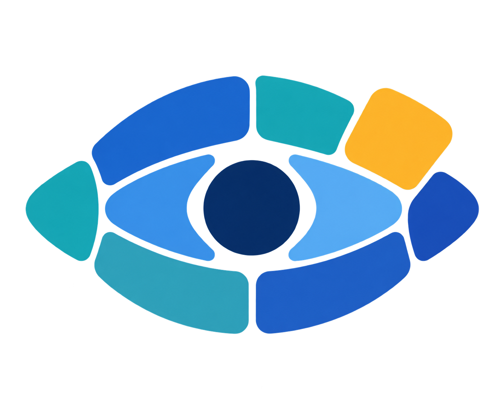
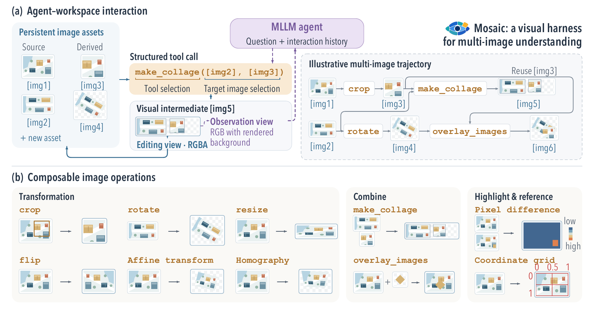

<div align="center">


<h1>Mosaic</h1>
<p><strong>Rethinking Multi-Image Re-Representation in Multi-Image Understanding</strong></p>
<p>
  <a href="https://gengyuanmax.github.io/">Gengyuan Zhang</a> ·
  <a href="https://github.com/77Han329">Xiao Han</a> ·
  <a href="https://scholar.google.com/citations?hl=en&amp;user=7coYsJsAAAAJ">Xinyu Xie</a> ·
  <a href="https://tongliu-github.github.io/">Tong Liu</a> ·
  <a href="https://www.dbs.ifi.lmu.de/~tresp/">Volker Tresp</a>
</p>
<p>
  <a href="https://arxiv.org/abs/2609.39363">Paper</a> ·
  <a href="https://gengyuanmax.github.io/Mosaic/">Project page</a> ·
  <a href="https://huggingface.co/spaces/gengyuanmax/MosaicGym">Toolbox Playground</a> ·
  <a href="https://huggingface.co/datasets/gengyuanmax/MosaicBench">Dataset</a>
</p>
<p>
  <a href="#overview"></a>
  <a href="#demo"></a>
  <a href="#models"></a>
  <a href="#mosaicbench"></a>
  <a href="#quick-start"></a>
  <a href="#citation"></a>
</p>

</div>

## Overview

Mosaic gives vision-language models an image workspace: they can crop, rotate, align, combine and compare images, then use the resulting visual evidence to answer a question. MosaicAgent-8B learns to use this workspace through reinforcement learning with accuracy and format rewards.

**MosaicGym preserves RGBA images, including the alpha channel.** Transparent areas remain transparent when images are transformed and composed, so generated images can become inputs to subsequent tools.



## Demo

| Demo | What you can explore |
| --- | --- |
| [Trajectory replay](https://gengyuanmax.github.io/Mosaic/#demo) | 796 recorded MosaicBench trajectories from MosaicAgent-8B: input images, questions, ground truth, model responses, tool calls and workspace updates. Browse by task or tool, select a step, or play the conversation. |
| [MosaicGym Playground](https://gengyuanmax.github.io/Mosaic/#alpha-canvas) | Run all ten tools on the provided example images, inspect RGBA and alpha views, and compose results in the workspace. The interface calls the same Python Toolbox used by the evaluation runner. |

The trajectory viewer replays recorded model outputs. The Playground executes image tools on CPU; it does not run a language model. It is also available directly on [Hugging Face Spaces](https://huggingface.co/spaces/gengyuanmax/MosaicGym).

<details>
<summary><strong>Run the Toolbox Playground locally</strong></summary>

From a checkout of this repository, using Python 3.12:

```bash
python3.12 -m venv .venv-demo
source .venv-demo/bin/activate
python -m pip install -r demo/requirements.txt
python demo/server.py --port 8767
```

Open [localhost:8767](http://127.0.0.1:8767/#alpha-canvas). See the [service guide](demo/README.md) for deployment and the [Playground guide](docs/PLAYGROUND.md) for workspace and transparency behavior.

</details>

## Models

| Model | Role | Download |
| --- | --- | --- |
| **MosaicAgent-8B** | Qwen3-VL-based model trained with image tools | [Hugging Face](https://huggingface.co/gengyuanmax/MosaicAgent-8B) |
| **MosaicLLM-8B** | No-tool, single-turn comparison model | [Hugging Face](https://huggingface.co/gengyuanmax/MosaicLLM-8B) |

See each Model Card for its base model, intended use, inference requirements and license. The [quick start](#quick-start) below runs MosaicAgent with the tool environment.

## MosaicBench

MosaicBench includes **32 task types described in the paper**. The public evaluation release contains **560 samples**, including questions, ordered candidate answers, ground truth and image references.

| Included in the public release | Coverage |
| --- | --- |
| Questions, candidate answers and ground truth | All 560 samples |
| Bundled images | 780 images covering 540 samples |
| COCO-derived samples | 20 samples with source links and filenames; images are not bundled |

[Download MosaicBench](https://huggingface.co/datasets/gengyuanmax/MosaicBench) · [Dataset Card and source licenses](https://huggingface.co/datasets/gengyuanmax/MosaicBench#sources-and-terms)

The complete benchmark definition and the subset runnable with bundled images are distinct. Source images retain their own license terms. Training data is not part of this release.

## Quick start

Python 3.10 or newer is required for the evaluation package. Model serving needs a separate Qwen3-VL-compatible environment and sufficient GPU memory.

### 1. Install

```bash
git clone https://github.com/gengyuanmax/Mosaic.git
cd Mosaic
python -m pip install -e .
python -m pip install huggingface_hub
```

### 2. Prepare MosaicBench

```bash
hf download gengyuanmax/MosaicBench --repo-type dataset --local-dir data/MosaicBench
python scripts/data_prep/prepare_mosaicbench.py data/MosaicBench data/mosaicbench
```

This preserves prompts, choices, answers and image order, prepares the 540 samples with bundled images, and writes a coverage report for the 20 excluded samples. It does not download COCO images or change the benchmark split.

### 3. Serve the model and run an example

In a compatible vLLM environment:

```bash
vllm serve gengyuanmax/MosaicAgent-8B --dtype bfloat16 --port 8000
```

Then, from this repository:

```bash
mosaic-run --dataset mosaicbench --env tool \
  --model-name gengyuanmax/MosaicAgent-8B \
  --endpoint http://localhost:8000/v1 --max-samples 1
```

Set the serving context length and image limits for your hardware and workload. The explicit BF16 setting matches the stored checkpoint tensors. The runner executes model-generated tool calls and returns the resulting images to the model.

Outputs are written to `outputs/mosaicbench/record/`. Remove `--max-samples 1` to run the prepared subset; report its coverage when presenting results.

## Documentation

| Guide | Contents |
| --- | --- |
| [Usage guide](docs/usage.md) | Installation, evaluation settings, other benchmarks, containers and training adapters |
| [Toolbox service](demo/README.md) | Local Playground setup and Docker Space deployment |
| [Replay format](docs/REPLAY_FORMAT.md) | Dataset/model collections and recorded trajectory format |
| [Dataset preparation](scripts/data_prep/README.md) | Benchmark converters |

<details>
<summary><strong>Repository layout</strong></summary>

- [`src/mosaic_gym/toolbox/`](src/mosaic_gym/toolbox/): ten image operations and image-state management.
- [`src/mosaic_gym/agent/`](src/mosaic_gym/agent/): prompting, tool-call parsing and conversation management.
- [`src/mosaic_gym/runner/`](src/mosaic_gym/runner/): dataset loading, multi-turn evaluation and scoring.
- [`src/mosaic_gym/rl/`](src/mosaic_gym/rl/) and [`rl/`](rl/): training adapters and vendored verl.
- [`scripts/data_prep/`](scripts/data_prep/): benchmark converters, including the HF MosaicBench bridge.
- [`docs/`](docs/): project page and recorded trajectory library.
- [`demo/`](demo/): native Toolbox web service.

</details>

<details>
<summary><strong>Development checks</strong></summary>

CPU protocol checks:

```bash
python -m pip install -e '.[dev]'
python -m pytest tests
```

In the Playground environment, compare service outputs with direct Toolbox calls:

```bash
python demo/test_server.py
```

Replay and asset checks (Node.js required):

```bash
node --test demo/test_homepage_library.mjs demo/test_homepage_interaction.mjs
```

</details>

## Citation

```bibtex
@misc{zhang2026mosaic,
  title={Rethinking Multi-Image Re-Representation in Multi-Image Understanding},
  author={Gengyuan Zhang and Xiao Han and Xinyu Xie and Tong Liu and Volker Tresp},
  year={2026},
  eprint={2609.39363},
  archivePrefix={arXiv},
  primaryClass={cs.CV},
  url={https://arxiv.org/abs/2609.39363}
}
```

## License

Mosaic code uses the [MIT license](LICENSE). Vendored verl retains its [Apache 2.0 license](rl/verl/LICENSE) and attribution. Model and dataset licenses are documented in their respective Hugging Face repositories. Demo images retain their [source-specific licenses and attribution](docs/assets/replays/LICENSE.md). 
